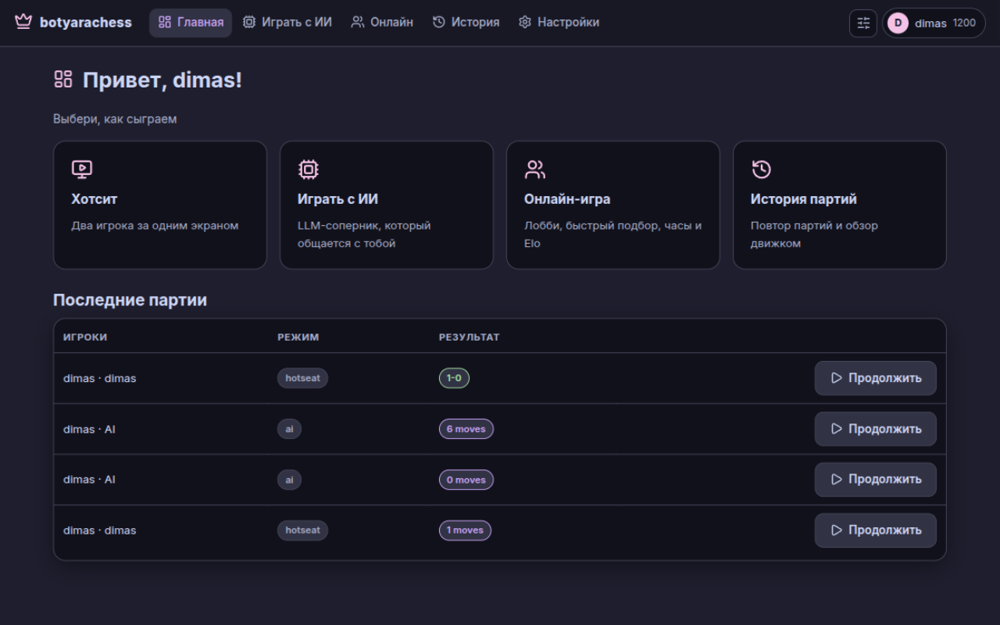
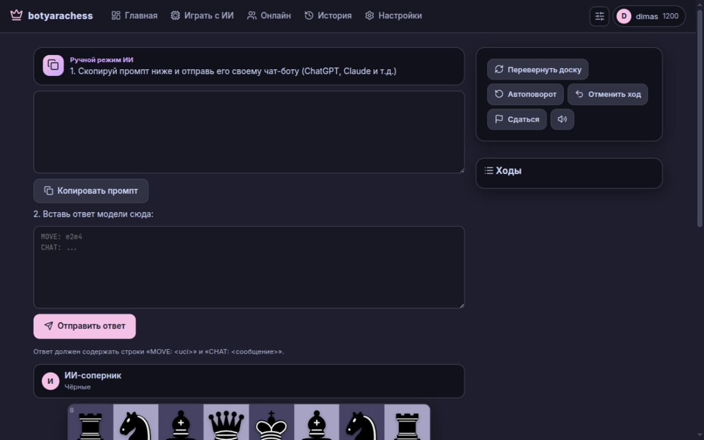
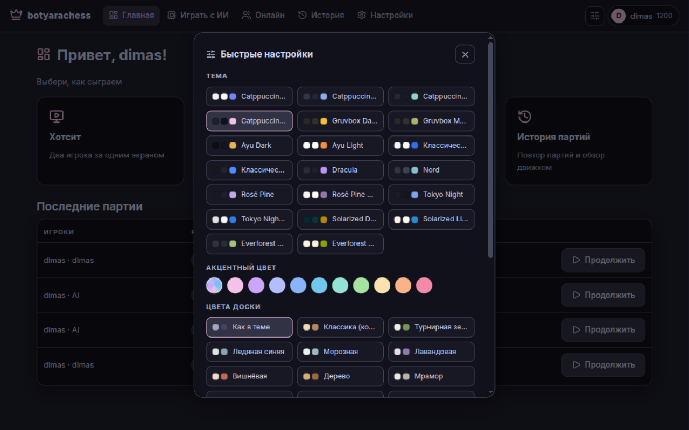
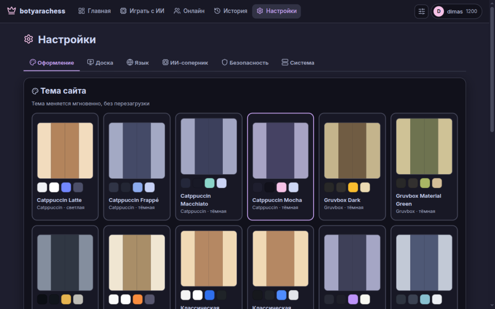
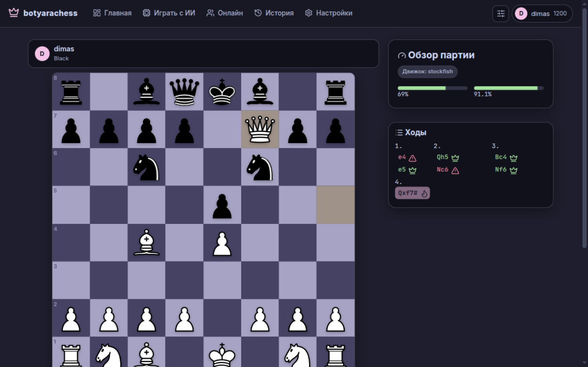
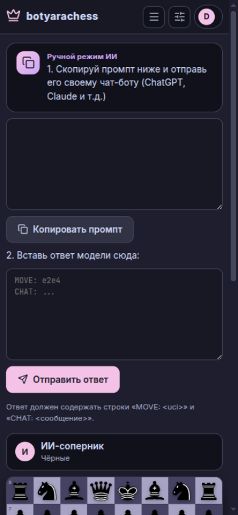

# botyarachess ♞

Полноценное шахматное веб-приложение на Flask + python-chess, которое
работает **полностью офлайн** (в локальной сети, без единого CDN) и умеет
играть с **настоящим LLM-соперником, который общается с тобой**.

| | |
|---|---|
|  |  |
|  |  |
|  |  |

## Возможности

- **Хотсит** — два игрока за одним экраном, автоповорот доски, отмена хода.
- **Игра с ИИ (LLM)** — модель ходит и **болтает**: комментирует партию и
  отвечает на твои сообщения. Панель чата расположена над доской.
  Провайдеры: OpenAI, Anthropic (Claude), Google Gemini, LM Studio (по
  IP:порту), любой OpenAI-совместимый сервер (Ollama, OpenRouter, Groq,
  llama.cpp…) и **ручной режим** — копируешь промпт в любой чат-бот и
  вставляешь его ответ обратно в поле.
  - Промпт всегда на английском (позиция FEN + ASCII-доска + история ходов +
    сообщение игрока + список легальных ходов), а язык ответа выбирается по
    локали («отвечай по-русски» / «in English»).
  - Если модель ответила **нелегальным ходом**, сервер до 3 раз отправляет
    корректирующий промпт (второй запрос со списком легальных ходов), а в
    крайнем случае играет случайный ход и извиняется.
  - Персоны: дружелюбный тренер, гроссмейстер, треш-токер или своя.
- **Онлайн** — Flask-SocketIO: лобби с открытыми вызовами, вход по коду,
  быстрый подбор (матчмейкинг), часы (1+0 / 3+2 / 5+0 / 10+0) с флагом на
  сервере, чат, предложения ничьей, реванш, Elo-рейтинг (K=20) для рейтинговых
  партий, переподключение с окном 20 секунд.
- **Обзор партий** — локальный движок считает перевес каждого хода,
  классифицирует (лучший / отличный / хороший / неточность / ошибка / зевок),
  считает точность по модели lichess и рисует график перевеса.
  Если **stockfish не установлен — берётся gnuchess; если нет и его — обзор
  недоступен** (в настройках видно статус).
- **20 тем оформления** — Catppuccin (×4), Gruvbox (Dark / Material),
  Ayu (Dark / Light), Rosé Pine (Dark / Dawn), Tokyo Night (Dark / Day),
  Solarized (Dark / Light), Everforest (Dark / Light), Dracula, Nord и две
  классические. Плюс **акцентный цвет** с палитрой, уникальной для каждой
  темы, и **отдельные цвета доски** (13 схем: классика, турнирная зелёная,
  дерево, мрамор, неон…). Переключение **без перезагрузки** через
  CSS-переменные, выбор сохраняется в профиле и localStorage.
- **Быстрые настройки** — единый оверлей в шапке: тема, акцент, доска, язык.
- **Расширенные настройки** — вкладки Оформление / Доска / Язык / ИИ /
  Безопасность / Система: размер шрифта, размер доски, громкость звуков,
  «меньше движения», показ съеденных фигур, смена пароля, удаление аккаунта
  с подтверждением и экспорт всех своих данных в JSON.
- **Локализация RU/EN** — автодетект по языку браузера, ручной выбор в
  настройках и в шапке.
- **Профиль** — статистика побед/поражений/ничьих, рейтинг, история партий,
  экспорт PGN.
- Мобильная адаптация (гамбургер-меню, доска на всю ширину, bottom-sheet
  модалки), звуки ходов синтезируются через WebAudio (без аудиофайлов),
  иконки Lucide инлайнятся в SVG.

## Быстрый старт

```bash
cd botyarachess
python -m venv .venv
.venv/bin/pip install -r requirements.txt
.venv/bin/python run.py
```

Открой <http://localhost:15989> (сервер слушает `0.0.0.0:15989`, так что
соседи по сети тоже смогут зайти). Зарегистрируйся — и вперёд.

## Настройка ИИ-соперника

**Настройки → Соперник ИИ**:

| Провайдер | Что заполнить |
|---|---|
| OpenAI | API-ключ, модель (например `gpt-4o-mini`) |
| Anthropic | API-ключ, модель (`claude-sonnet-4-20250514`) |
| Google Gemini | API-ключ, модель (`gemini-2.0-flash`) |
| LM Studio | IP/hostname машины с LM Studio + порт (по умолчанию 1234), имя модели |
| OpenAI-совместимый | Base URL (например `http://192.168.1.50:11434/v1` для Ollama), ключ (если нужен), модель |
| Ручной режим | ничего — промпт копируется в буфер прямо из игры |

Кнопка **«Проверить связь»** дёргает провайдера и показывает его ответ.
Ключи хранятся только в локальной базе (`instance/botyarachess.db`).

## Обзор партий (движок)

Приложение ищет движок в таком порядке: путь из `botyarachess/config.py`
(`STOCKFISH_PATH` / `GNUCHESS_PATH`) → `stockfish` в PATH → `gnuchess` в
PATH. Stockfish работает по UCI, gnuchess — по XBoard/CECP (обе схемы
поддержаны). Кнопка запуска обзора — в профиле/истории у завершённых партий;
глубина: fast / normal / deep.

```bash
# Arch/CachyOS
sudo pacman -S stockfish   # или gnuchess
```

## Структура проекта

```
run.py                     # точка входа: socketio.run на 0.0.0.0:15989
botyarachess/
├── config.py              # пути, SECRET_KEY (генерится в instance/), порт
├── extensions.py          # db / login_manager / csrf / socketio
├── models.py              # User, Game, ChatMessage (SQLite)
├── localization/strings.py
├── routes/                # auth, main, play, api (REST)
├── games/
│   ├── service.py         # вся шахматная логика на python-chess
│   ├── manager.py         # комнаты, матчмейкинг, часы
│   └── events.py          # SocketIO-события
├── ai/
│   ├── providers.py       # OpenAI / Anthropic / Gemini / LM Studio / compat
│   ├── prompts.py         # промпты, персоны, парсинг MOVE/CHAT
│   └── opponent.py        # ретраи нелегальных ходов, fallback
└── engine/review.py       # stockfish → gnuchess → недоступен
static/
├── css/                   # themes.css (10 тем), base, board, responsive
├── js/                    # ES-модули: core/ board/ game/ pages/
├── vendor/                # chess.js, socket.io.min.js (локально)
├── fonts/                 # Inter + JetBrains Mono (woff2, latin+кириллица)
└── img/pieces/            # 12 SVG-фигур Cburnett
scripts/                   # download_assets.py, build_icons.py, mock_llm.py,
                           # test_backend.py, test_online.py
```

## Тесты

Сервер должен быть запущен (`python run.py`), затем:

```bash
.venv/bin/python scripts/test_backend.py   # auth, хотсит, PGN, обзор, ИИ, ручной режим
.venv/bin/python scripts/mock_llm.py &     # эмулятор OpenAI-совместимого API
.venv/bin/python scripts/test_online.py    # матчмейкинг, часы, Elo, чат
```

`scripts/mock_llm.py` — крошечный фейковый LLM на `127.0.0.1:15990`: первый
ответ специально нелегальный, чтобы проверить механизм ретраев.

## Важные мелочи

- Порт и хост меняются в `botyarachess/config.py` (по умолчанию **15989**).
- База и секретный ключ живут в `instance/`.
- Всё статическое — локальное: сайт работает в закрытой сети без интернета.
- Это dev-сервер на Werkzeug; для постоянного продакшена подними через
  gunicorn+eventlet или поставь reverse-proxy.
